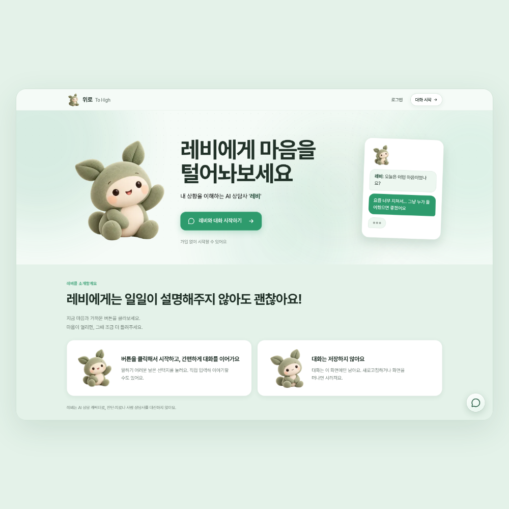
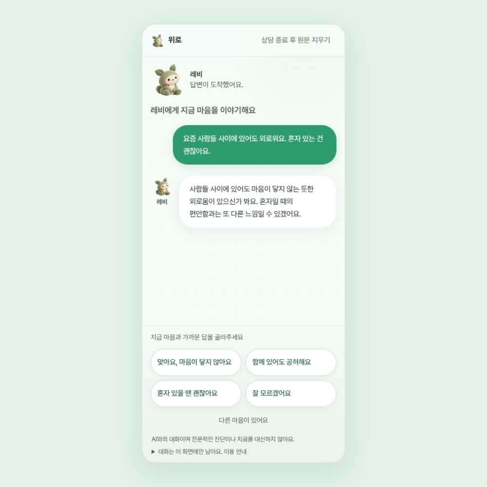

<div align="center">
  

# 위로 · 레비

**레비에게 마음을 털어놔보세요.**

말로 설명하기 어렵다면, 지금 마음과 가까운 버튼부터 눌러보세요.<br>
가입 없이 시작하고, 마음이 열리면 조금 더 들려주셔도 좋아요.

[서비스 이용하기](https://www.wirocare.com/) · [레비와 대화하기](https://www.wirocare.com/talk)

[](./LICENSE)

</div>

## 서비스 화면

| 데스크톱 · 레비 소개 | 모바일 · 선택지로 이어가는 대화 |
| --- | --- |
|  |  |

두 이미지는 저장소 코드로 촬영한 1:1 화면입니다. 모바일 대화는 실제 사용자 정보가 없는 모의 응답이며, 운영 사이트의 배포 상태와는 다를 수 있습니다.

## 레비와 대화하는 방법

1. **가입 없이 시작해요.** 홈에서 레비와 대화를 시작합니다.
2. **지금 마음과 가까운 답을 골라요.** 레비의 응답에 맞춰 다음 선택지가 나타납니다.
3. **더 들려주고 싶다면 직접 적어요.** ‘다른 마음이 있어요’를 누르면 입력창이 열립니다.
4. **그만하고 싶을 때 마쳐요.** ‘상담 종료 후 원문 지우기’를 누르면 이 화면의 대화와 입력을 지웁니다.

레비는 **AI 상담 캐릭터**예요. 진단·치료나 사람 상담사를 대신하지 않아요.

## 주요 기능

- **선택지 중심 대화** — 처음부터 상황을 길게 설명하지 않아도 시작할 수 있습니다.
- **필요할 때만 직접 입력** — 입력창을 기본으로 접어 두고, 선택지를 누른 뒤 모바일 키보드를 자동으로 열지 않습니다.
- **실시간 응답** — 답변을 스트리밍으로 먼저 보여주고, 이어서 답변에 맞는 선택지를 제공합니다.
- **대화 맥락 유지** — 대화가 길어지면 오래된 내용을 일시적으로 요약해 이어갑니다.
- **상황별 오류 안내** — 연결 끊김·시간 초과·이용량 한도 등을 구분하고, 전송 실패 시 입력을 복구합니다.
- **홈페이지 후원·문의** — [show-me-the-coffee](https://github.com/fullth/show-me-the-coffee)와 채널톡을 사용합니다. 모바일 후원 창은 QR을 숨기고 카카오페이 버튼을 유지합니다.

현재 공개 채팅은 기본 대화 모드와 따뜻한 말투로 시작합니다. 응답 모드·MBTI 선택 화면, 개인 캐릭터·기억 관리, 감정 일기·구독은 공개 기능에 포함하지 않습니다. 이전 키워드 기반 위기 안내 UI도 현재 채팅에는 표시하지 않습니다.

## 대화와 개인정보

**대화 원문과 대화를 이어가기 위한 요약을 서비스 데이터베이스에 저장하지 않습니다.** 현재 화면의 메모리에만 유지하며, 종료·새로고침·페이지 이동 후 다시 불러오지 않습니다.

답변을 만들기 위해 서버와 AI 제공자가 대화를 처리합니다. 모델 요청에는 `store: false`를 적용하지만, 제공자 측 보관과 호스팅·프록시 로그는 각각의 정책과 설정을 따릅니다.

문의·후원 위젯은 홈페이지에서만 로드합니다. 채팅 화면에서는 브라우저 Sentry 오류·Replay·추적 전송을 비활성화하고, 서버는 설정 시 허용된 숫자 지표만 전송합니다.

자세한 내용은 [개인정보 처리 안내](https://www.wirocare.com/privacy)와 [대화 처리·지표 문서](./docs/chat-streaming-and-metrics.md)를 확인하세요.

## 로컬에서 실행하기

Node.js 24 LTS와 npm을 권장합니다. 저장소 루트에서 의존성을 설치하세요.

```bash
npm ci
```

**화면과 동작만 확인하려면**, Python 3을 설치한 뒤 격리된 모의 서버를 실행합니다. MongoDB·OpenAI 키 없이 사용할 수 있습니다.

```bash
python3 scripts/local-test/run.py restart --build
```

- 홈: `http://127.0.0.1:3102/`
- 채팅: `http://127.0.0.1:3102/talk`
- 종료: `python3 scripts/local-test/run.py stop`

이 모드의 답변은 `[로컬 모의 응답]`입니다. 실제 모델의 상담 품질을 확인하는 용도는 아닙니다. 빌드에는 Google Fonts 다운로드가 필요하며, 실행 환경에 따라 네트워크 설정이 필요합니다.

실제 AI 연결, 환경변수, 개발 서버와 테스트 방법은 [개발 가이드](./docs/development.md)를 참고하세요.

## 기술 구성

| 영역 | 사용 기술 |
| --- | --- |
| 웹 | Next.js 16 · React 19 · TypeScript · Tailwind CSS 4 |
| API | NestJS 11 · TypeScript · Zod · SSE |
| AI | OpenAI · 대화 응답 / 선택지 / 일시 요약 생성 |
| 데이터 | MongoDB · Mongoose — 공개 채팅 원문·요약은 저장하지 않음 |
| 운영 | Vercel (웹) · Railway (API) · 선택적 Sentry 서버 지표 |
| 저장소 | npm workspaces |

```text
to-high/
├── apps/
│   ├── web/                 # 랜딩·채팅 화면
│   └── api/                 # 대화 API·모델 연결·입력 검증
├── docs/                    # 개발·대화 품질·운영 문서
└── scripts/local-test/      # 외부 모델·DB 없는 격리 실행
```

## 개발 문서

| 문서 | 내용 |
| --- | --- |
| [개발 가이드](./docs/development.md) | 환경변수, 실행, 빌드, 검증 방법 |
| [현재 구조와 운영 경계](./docs/architecture.md) | 공개 기능, 이전 API, 요청 제한, 비용 예산 |
| [스트리밍·요약·Sentry 지표](./docs/chat-streaming-and-metrics.md) | 응답 흐름, 오류 처리, 지표 설정과 전송 경계 |
| [상담 품질 평가](./docs/counseling-quality.md) | 합성 대화로 답변과 선택지를 평가하는 방법 |
| [격리 로컬 테스트](./scripts/local-test/README.md) | 모의 서버 상세 동작과 프로세스 관리 |
| [AI 프롬프트 코드](./apps/api/src/prompts/index.ts) | 공통 규칙·응답 모드·말투·주제별 지침 |

## 라이선스

저장소 자체 저작물은 [CC BY-NC-ND 4.0](./LICENSE)을 따릅니다. 비상업적 원본 공유는 가능하지만, 이 라이선스는 수정본 공유나 상업적 이용을 허용하지 않습니다. 별도 이용은 권리자의 서면 허가가 필요합니다.

공유 시 저작자 표시와 라이선스 고지를 유지해야 합니다. 제3자 코드·로고·이미지·의존성에는 각각의 별도 권리가 적용됩니다. 정확한 범위와 법률상 예외는 [LICENSE](./LICENSE) 및 [공식 전문](https://creativecommons.org/licenses/by-nc-nd/4.0/legalcode.en)을 확인하세요.
