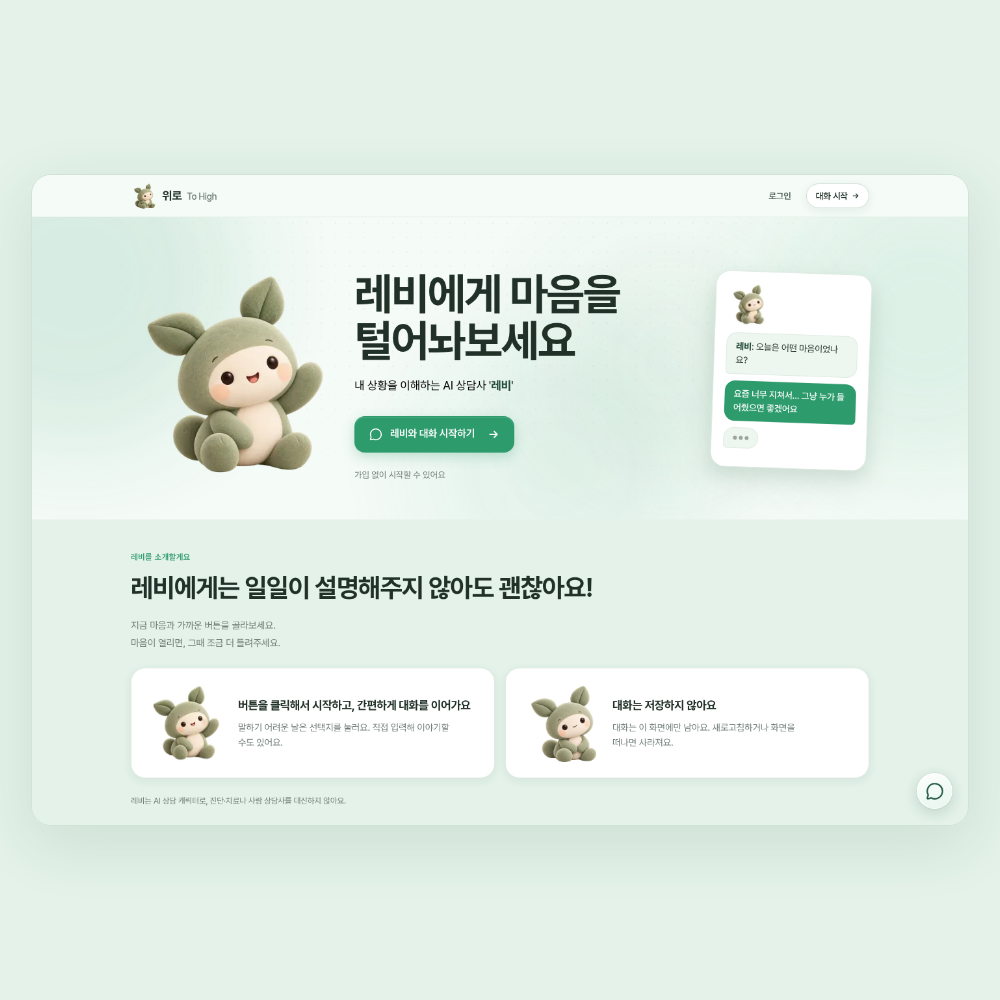
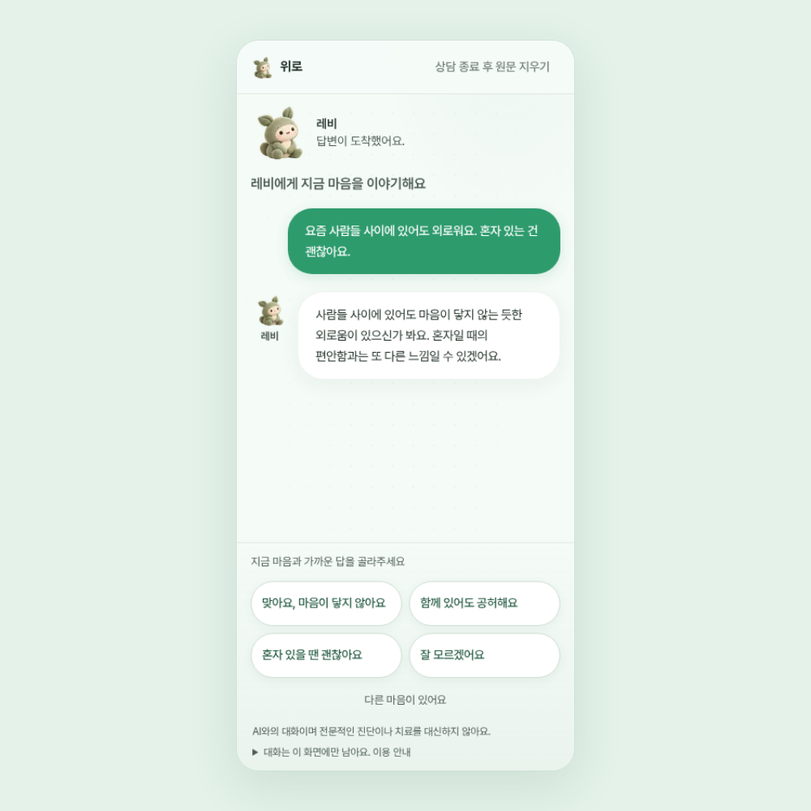

  

# 위로

**레비에게 마음을 털어놔보세요**

내 상황을 이해하는 AI 상담사 '레비'

[레비와 대화 시작하기](https://www.wirocare.com/talk)

가입 없이 시작할 수 있어요.

## 레비를 소개할게요

### 레비에게는 일일이 설명해주지 않아도 괜찮아요!

지금 마음과 가까운 버튼을 골라보세요. 
마음이 열리면, 그때 조금 더 들려주세요.

| 레비를 만나보세요 | 이렇게 대화를 나눠요 |
| --- | --- |
|  |  |

대화 화면은 이용 예시예요.

## 버튼을 클릭해서 시작하고, 간편하게 대화를 이어가요

말하기 어려운 날은 선택지를 눌러요. 직접 입력해 이야기할 수도 있어요.

레비의 이야기를 읽고, 지금 마음과 가까운 답을 골라주세요. 더 들려주고 싶은 마음이 있다면 **‘직접 입력할게요’**를 눌러주세요.

## 원할 때만 대화를 저장해요

저장하지 않은 대화는 화면을 떠나면 사라져요. 상담 종료 시 저장을 선택하면 로그인 계정에 보관하고 다시 볼 수 있어요.

답변과 저장 제목 생성을 위해 대화는 서버와 AI 제공자가 처리해요. 선택해 저장한 대화는 계정에 보관되며, 제공자 측 보관은 해당 정책과 설정에 따라요.

[개인정보 처리 안내](https://www.wirocare.com/privacy)

레비는 AI 상담 캐릭터로, 진단이나 치료나 사람 상담사를 대신하지 않아요.

## 지금, 레비와 이야기해볼까요?

안녕하세요, 레비예요. 
지금 어떤 마음인지 들려주실래요?

[레비와 대화 시작하기](https://www.wirocare.com/talk)
